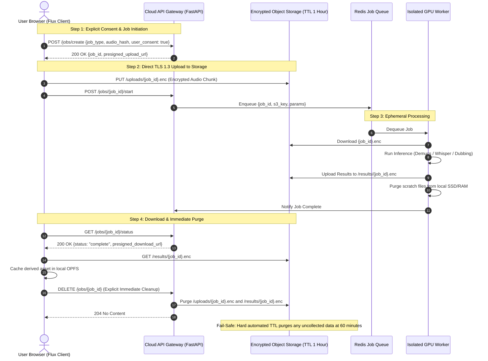

# Privacy Policy Skeleton & Cloud Data-Flow Architecture

> **Privacy-First Core Principle (PLAN.md §0 Principle 6):** 
> By default, all audio processing, DSP effects, timeline editing, project storage, and basic AI features execute strictly **on-device** inside the user's browser engine. No audio, transcripts, or filenames are ever logged or transmitted without explicit, per-feature user consent.

---

## 1. On-Device vs Cloud Processing Boundaries

| Feature Category | Execution Realm | Network Traffic | User Consent Required? |
|---|---|---|---|
| Playback, Timeline, DSP Effects Rack | Local Browser (`AudioWorklet` / WASM) | None ($0\text{ bytes}$) | None (Local execution) |
| Local Recording | Local Browser (OPFS) | None ($0\text{ bytes}$) | Browser mic permission only |
| Basic AI (VAD, Noise Gate, Fast Stems) | Local WebGPU / WASM-SIMD | Model asset downloads only (CDN) | None (Runs locally) |
| Project Storage (`.flux`, OPFS) | Local Browser File System | None ($0\text{ bytes}$) | None |
| **Heavy Cloud Stems (HTDemucs-HQ)** | Remote GPU Worker | Audio upload & download via TLS 1.3 | **Explicit Opt-in Toggle** |
| **Multilingual Dubbing & Large TTS** | Remote GPU Worker | Audio/transcript upload & download | **Explicit Opt-in Toggle** |
| **Voice Cloning** | Remote GPU Worker | Audio sample upload | **Explicit Consent Attestation** |

---

## 2. Cloud Architecture & Data-Flow Lifecycle

When a user explicitly chooses to run an opt-in cloud operation, data moves through an ephemeral, zero-retention pipeline:

---

## 3. Data Protection Guarantees

1. **Zero Retention Policy:**
   - Audio files and derived assets uploaded to the cloud exist exclusively for the duration of the requested processing job.
   - S3 buckets enforce a strict automated Lifecycle Expiration Rule of 60 minutes.
   - Calling `DELETE /jobs/{job_id}` immediately destroys both source audio and output results.
2. **Encryption in Transit & at Rest:**
   - All network communication is restricted to TLS 1.3 with modern cipher suites.
   - All object storage assets are encrypted at rest using AES-256 (SSE-S3 or customer-managed KMS keys).
3. **No Training on User Audio:**
   - User audio submitted to cloud processing nodes is never logged, never archived, and never used for machine learning model training or fine-tuning.
4. **Machine-Readable AI Attribution:**
   - All generated, converted, or cloned speech generated by Flux embeds standardized provenance metadata (e.g. C2PA or ID3 `TXXX:AI_GENERATED_CONTENT` tags) to comply with emerging international transparency standards (including the EU AI Act).
5. **No Telemetry Intrusion:**
   - Application monitoring tools (e.g., Sentry error reporting) are strictly configured with session replay disabled and privacy filters active, forbidding transmission of audio payloads, transcription strings, or file paths.

---

## 4. Privacy Policy Skeleton

The customer-facing Privacy Policy will explicitly declare:
1. **Local Operation:** Core audio processing occurs on the client device.
2. **Data Collected for Accounts:** Only email and payment tokens (processed by Stripe or equivalent) when purchasing Pro features.
3. **Data Collected for Cloud Audio:** Transient audio chunks retained for up to 60 minutes solely to execute user-requested processing.
4. **User Rights:** Right to inspect, export, and delete all cloud-associated records at any time.
5. **Contact and Data Protection Officer:** Contact mechanism for privacy inquiries and GDPR/CCPA data deletion requests.
